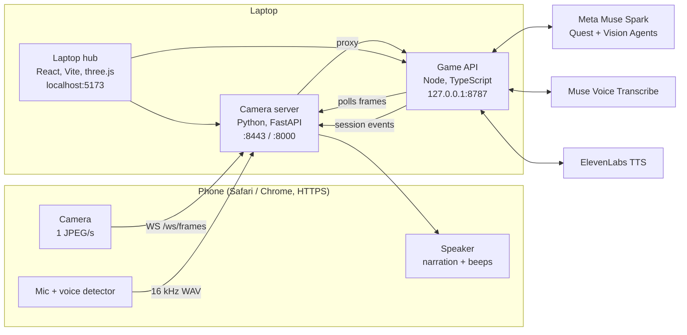

<div align="center">

# Lumi

**See the room. Hear the way.**

Lumi turns a phone camera into calm, spoken, step-by-step guidance for people who are blind or have low vision.

**Built at [HackTX](https://hacktx.com) 2026** at the University of Texas at Austin


</div>

---

Hold the phone at chest height and say *"Hi Lumi, help me throw away my coffee."* Lumi finds the cup, guides your hand to it, and leads you to the trash, confirming each step on camera before it moves on.

> Lumi supplements a cane, a guide dog, and orientation and mobility training. It is not an obstacle-avoidance system.

## Why Lumi

Most vision-assistance apps describe a scene: *"a desk with a cup, a laptop, and a lamp."* That helps you know what's there, but not how to do something with it. Everyday tasks like clearing a desk, finding a seat, or throwing something away need guidance that is spatial ("a little to your left, about an arm's length"), step by step, and confirmed, so you know that you actually grabbed the right object before moving on.

Lumi is built around that loop. It plans a task from what the camera can see, guides you by touch and sound one step at a time, and checks each step on camera before continuing. When it isn't sure, it says so and asks you to adjust instead of guessing.

## How it works

1. **Perceive.** The phone sends one camera frame per second. While a task is running, Lumi analyzes the newest frame at most every 2.5 seconds.
2. **Understand.** The **Vision Agent** locates the target and your hand, estimates direction and distance, and flags hazards (sharp, hot, fragile, or a trip risk).
3. **Guide.** The **Quest Agent** plans the task using only objects the camera has seen or that you named, then speaks one short, touch-based step at a time. Stereo beeps pan toward the target and get faster and higher as your hand gets closer.
4. **Verify.** When a step looks done, the Vision Agent answers a yes/no check with `PASS`, `FAIL`, or `UNCERTAIN`. Only `PASS` advances the task. A verdict below 0.55 confidence counts as `UNCERTAIN`, and Lumi asks you to adjust instead of guessing.
5. **Map.** The laptop dashboard builds an approximate 3D model of the room from a single viewpoint. Each object is labeled observed, estimated, or seen earlier. Objects the task expects but the camera hasn't seen are listed, not drawn.

You can ask questions at any time (*"Is the desk clear?"*, *"Where are my headphones?"*). For 20 seconds after Lumi speaks, follow-ups don't need the wake phrase, but starting a new task always does. When a task is finished, Lumi can offer to text a contact through the Mac's Messages app, and it only sends after you confirm.

## Features

- **Hands-free voice control.** A local wake phrase ("Hi Lumi") and voice detection, with Meta Muse Voice Transcribe biased toward the task's objects.
- **Touch-based, step-by-step guidance.** Short spoken directions plus stereo beeps that pan toward the target and speed up as your hand gets closer.
- **Camera-verified progress.** Each step is confirmed with a `PASS`, `FAIL`, or `UNCERTAIN` verdict before Lumi moves on.
- **Hazard awareness.** Sharp, hot, fragile, and trip-risk objects are called out.
- **Live 3D room map.** A three.js reconstruction from a single camera view, with every object labeled by how confident Lumi is about it.
- **Laptop hub.** A live dashboard showing the camera feed with bounding boxes, step status, Lumi's current understanding of the scene, and a transcript.
- **Private by design.** The phone never holds API keys. Only the local game API talks to external services, and it scrubs keys from logs and errors.
- **Works without keys.** With no API keys set, Lumi runs on scripted mock vision, which is useful for rehearsing a demo.

## Architecture



- **The phone only talks to the camera server,** which holds no API keys.
- **The game API is the only process that calls external services.** It listens on `127.0.0.1`, sends keys in headers, and scrubs them from logs and errors.
- **The game API owns all task state,** so the phone and the dashboard always agree.

| Job | Service |
| --- | --- |
| Quest Agent (plan, narrate, hint, answer) | Meta **Muse Spark** |
| Vision Agent (step observations, room surveys, PASS/FAIL checks) | Meta **Muse Spark** vision |
| Speech to text, with the wake word and task objects as keywords | Meta **Muse Voice Transcribe** |
| Narrator voice | **ElevenLabs** `eleven_flash_v2_5` (browser speech as fallback) |
| Wake phrase, beeps, voice detection | Local code, no API |

Gemini and OpenAI are optional alternatives for either agent (`QUEST_AGENT_PROVIDER`, `VISION_PROVIDER`). Muse Spark is the default and the fallback.

## Tech stack

| Layer | Technology |
| --- | --- |
| Game API | Node 22, TypeScript, Express 5 |
| AI | Meta Muse Spark (reasoning and vision), Muse Voice Transcribe; Gemini and OpenAI optional |
| Voice | ElevenLabs `eleven_flash_v2_5`, with the browser's Speech Synthesis as a fallback |
| Camera server | Python, FastAPI, Uvicorn, WebSockets, Pillow |
| Laptop hub | React 19, Vite, three.js |
| Phone client | Plain HTML and JavaScript served over self-signed HTTPS |
| Testing | pytest for the camera server, `tsc` for TypeScript |

## Getting started

**Requirements:** Node 22.9+, Python 3.10+, and a phone on the same Wi-Fi network as the laptop.

```bash
cp .env.example .env                 # add keys; with no keys, Lumi runs on scripted mock vision
npm install
python3 -m venv .venv && .venv/bin/pip install -r requirements.txt

npm run dev                          # game API (:8787) + laptop hub (http://localhost:5173)
.venv/bin/python run.py              # camera server (phone: https://<lan-ip>:8443)
```

1. Open **http://localhost:5173** on the laptop and go to **Connect**.
2. Scan the QR code with the phone and accept the certificate warning once.
3. Tap **Start** on the phone. This is the only tap: it enables the camera and microphone and keeps the screen awake.
4. Say **"Hi Lumi, help me tidy my desk."** The hub switches to **Live** automatically.

In loud rooms, use the text box on the phone instead. Typed requests don't need the wake phrase.

## The laptop hub

| Page | Purpose |
| --- | --- |
| **Overview** | What Lumi is and how it works |
| **Connect** | Pair the phone by QR code, or type a task |
| **Live** | One dashboard for the session: the camera view with target, destination, and hand boxes, plus direction and distance meters (switchable to the 3D map or a text view); the task and each step's status; what Lumi understands about the scene, hazards, and the latest verdict; and a live transcript bar with a text box and laptop audio |

## Configuration

All settings live in a single `.env`, and `.env.example` documents every variable.

| Variable | Default | Purpose |
| --- | --- | --- |
| `MODEL_API_KEY` | | Meta Model API key (Muse Spark and Voice Transcribe) |
| `ELEVENLABS_API_KEY` | | Cloud narrator voice. Leave blank to use on-device speech. |
| `QUEST_AGENT_PROVIDER`, `VISION_PROVIDER` | `muse` | `muse`, `gemini`, or `openai` (each needs its own key) |
| `AGENT_NAME` | `Lumi` | The wake phrase is "Hi \<name\>" |
| `AWAKE_MS` | `20000` | How long follow-ups skip the wake phrase |
| `VERIFY_STEPS` | `1` | `0` skips the Vision Agent's confirmation of each step |
| `SURVEY_INTERVAL_MS` | `60000` | How often the room is re-surveyed for the map (`0` disables it) |
| `CAMERA_LINK_INTERVAL_MS` | `2500` | Minimum time between analyzed frames during a task |
| `SHARE_ENABLED`, `SHARE_ONLY_TO` | on, unset | Messages sharing after a task (macOS). `SHARE_ONLY_TO` locks it to one recipient. |
| `SIDEQUEST_SESSION` | `demo` | Session the phone joins (or `?session=` on the phone URL) |

## Project layout

```text
server/        Game API (Node, TypeScript)
  index.ts       HTTP routes, frame polling, room-survey timer
  session.ts     Task state, step verification, wake-phrase handling, event stream
  questAgent.ts  Quest Agent: planning, narration, hints, answers, intent parsing
  vision.ts      Vision Agent: observations, surveys, PASS/FAIL/UNCERTAIN checks
  prompts.ts     System prompts and JSON schemas
  guidance.ts    Direction, proximity, and beep cues
  share.ts       Optional Messages sharing with explicit confirmation
  providers/     muse.ts, elevenlabs.ts, messages.ts, gemini.ts, openai.ts
web/           Laptop hub (React, Vite, three.js)
  pages/         Overview (Discover.tsx), Connect (Begin.tsx)
  session/       Live dashboard, 3D map (Spatial3D.tsx), text view
  lib/           Session state, single-view 3D reconstruction, speech, API client
app/           Camera server (Python, FastAPI): phone page, WebSockets, frame buffer, proxies
static/        Phone controller: camera, voice detection, narration, beeps
shared/        Types shared by the game API and the hub
tests/         Camera server tests (pytest)
frontend/      Earlier standalone UI, kept as a design reference (not used at runtime)
```

## Development

```bash
npm run typecheck        # TypeScript
npm run build            # production build of the hub (output in dist/)
.venv/bin/pip install -r requirements-dev.txt && .venv/bin/python -m pytest
```

The camera server's API docs are at http://localhost:8000/docs. To rehearse without a live task plan, start a scripted demo task (`desk`, `trash`, or `seat`) from the Connect page, or with:

```bash
curl -X POST localhost:8787/api/quest/start -H 'Content-Type: application/json' \
  -d '{"sessionId":"demo","presetId":"trash"}'
```

## Troubleshooting

- **"Camera API unavailable" on the phone:** open the `https://` URL and accept the certificate warning.
- **Certificate errors after changing networks:** the laptop's IP address changed. Run `.venv/bin/python scripts/gen_cert.py` and restart the camera server.
- **Hub shows "No phone yet":** both devices must be on the same Wi-Fi, with VPNs off and no client isolation. A phone hotspot is the most reliable option for demos.
- **Lumi doesn't respond:** start with "Hi Lumi." The phone's status line shows what it heard. "Voice failed" means the game API isn't running or Muse is unreachable.
- **Black video on iPhone after locking:** iOS pauses the camera in the background. Unlock the phone and tap **Restart camera**.

## Limitations

- A laptop on the same network must run both servers.
- Distances come from a single camera with no depth sensor, so they're ranges that assume the phone is held level at chest height.
- Each analysis takes a few seconds, so Lumi suits deliberate tasks, not fast movement.

## Team

Lumi was built in one weekend at **HackTX 2026** by:

- [Raghav Saravanan](https://github.com/raghavsaravanan)
- [Reventh Sathish Kumar](https://github.com/reventhTheCoder333)
